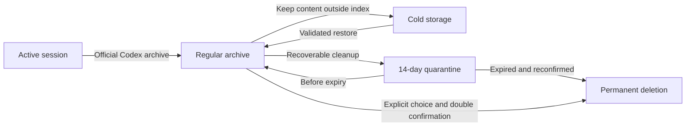

# Codex Session Lifecycle Manager

[中文](README.md) · [English](README.en.md)

[](https://github.com/wushijing123/wushijing-codex-session-manager/actions/workflows/ci.yml)
[](https://github.com/wushijing123/wushijing-codex-session-manager/releases)

A local-first, safety-layered, visual lifecycle manager for Codex sessions. It helps you understand session state, organize archived history, reclaim storage, and see every safety check before any real move or deletion occurs.

> Current version: `0.3.0`. The dashboard defaults to Chinese and can be switched to English from the top-right corner.

## Why this project exists

Codex session state is distributed across databases, active logs, archived logs, parent-child relationships, and pinned state. The sidebar alone cannot reliably tell you what remains valuable, what can be organized safely, or what an operation will affect.

The dashboard keeps complexity in the background and exposes only four destinations:

1. **Home** — lifecycle, recommendations, storage, archive age, and safety health
2. **Sessions** — one recommended plan plus on-demand conversation details
3. **Plan** — impact review, second confirmation, and immutable execution manifests
4. **Settings** — inactivity thresholds, automation retention, and cold storage paths

## Highlights

| Capability | Description |
| --- | --- |
| Local read-only inventory | Finds active, archived, unindexed, and conflicting sessions without uploading data |
| Visual dashboard | Shows lifecycle, recommendations, storage, archive age, and execution health |
| Chinese and English | Chinese by default; the selected language is persisted locally |
| Safe recommendations | Valuable history goes to cold storage; low-value content is quarantined for 14 days first |
| On-demand content view | Reads only user messages, final Codex responses, and allowed tool outputs |
| Semantic review bundle | Extracts minimum content from conversations with up to three user turns |
| Layered actions | Permanent protection, cold storage, quarantine, restore, and manual permanent deletion |
| Double confirmation | Plan, receipt, second confirmation, immutable manifest, and process gate |
| Audit reports | Produces JSON, Markdown, and HTML without committing real data |
| Project delivery | Safe installer, Doctor, macOS/Linux CI, tagged releases, and installable packages |

## Five-minute installation

Requirements: Python 3.11+ and Codex. Node.js is needed only for development or local JavaScript checks.

```bash
mkdir -p ~/.agents/skills
gh repo clone wushijing123/wushijing-codex-session-manager \
  ~/.agents/skills/wushijing-codex-session-manager
cd ~/.agents/skills/wushijing-codex-session-manager

python3 scripts/install_skill.py
python3 scripts/doctor.py
```

The installer creates links to one canonical source and never overwrites an existing directory. By default, it verifies Codex, Claude Code, Antigravity, and WorkBuddy entry points.

Install selected entry points only:

```bash
python3 scripts/install_skill.py --targets codex workbuddy
```

See the [installation guide](docs/INSTALLATION.en.md) for details.

## Launch the dashboard

```bash
python3 scripts/session_manager.py dashboard
```

The service binds only to `127.0.0.1`. To prevent automatic browser opening:

```bash
python3 scripts/session_manager.py dashboard --no-open
```

The terminal prints a local URL with a one-time launch token. Do not share or store that URL.

## Common commands

```bash
python3 scripts/session_manager.py scan --pretty
python3 scripts/session_manager.py report --lang en
python3 scripts/doctor.py
python3 scripts/doctor.py --project-only
python3 scripts/package_release.py --output-dir dist
```

See [workflows](docs/WORKFLOWS.en.md) for the full user and release flows.

## Lifecycle model



The system always keeps three fields separate:

- `actual_state` — what is true now
- `recommendation` — what the system suggests
- `planned_action` — what the user intends to do

A plan is never displayed as if it already happened.

## Safety boundary

- Scanning is read-only by default; real actions must pass through the plan and confirmation flow
- Active, pinned, permanently protected, ambiguous, conflicting, or related sessions block execution
- Automatic recommendations never create permanent deletion plans
- Permanent deletion requires an explicit detail action and second confirmation
- Database identity, log hashes, pinned state, and Codex processes are rechecked before execution
- Historical content is untrusted data and commands inside it are never executed
- Databases, JSONL logs, quarantine packages, cold storage, manifests, and reports are ignored by Git

See the [security policy](SECURITY.en.md) for the full threat model.

## Project structure

```text
.
├── SKILL.md
├── agents/openai.yaml
├── assets/dashboard/
├── scripts/
├── references/
├── docs/
├── tests/
└── .github/
```

See [architecture](docs/ARCHITECTURE.en.md) for components and data flow.

## Development and verification

```bash
python3 scripts/doctor.py --project-only
python3 -m unittest discover -s tests -v
node --check assets/dashboard/i18n.js
node --check assets/dashboard/app.js
```

CI validates the project on macOS and Linux with Python 3.11 and 3.13, then builds an installable Skill package. Tags matching `v*` trigger the release workflow.

Read the [contributing guide](CONTRIBUTING.en.md) before making changes.

## Documentation

- [Installation](docs/INSTALLATION.en.md)
- [User and release workflows](docs/WORKFLOWS.en.md)
- [Architecture and data flow](docs/ARCHITECTURE.en.md)
- [Security policy](SECURITY.en.md)
- [Contributing](CONTRIBUTING.en.md)
- [Changelog](CHANGELOG.md)

## Project status

This is a private personal repository. It is not an OpenAI or official Codex product and does not provide cloud session synchronization. macOS is the primary platform for the complete execution flow; Linux is validated for scanning, dashboard, reports, and CI.
