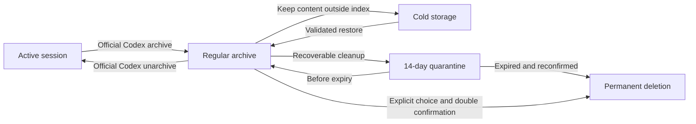

# Codex Session Lifecycle Manager

[中文](README.md) · [English](README.en.md)

[](https://github.com/wushijing123/wushijing-codex-session-manager/actions/workflows/ci.yml)
[](https://github.com/wushijing123/wushijing-codex-session-manager/releases)

A local-first, safety-layered, visual lifecycle manager for Codex sessions. It helps you understand session state, organize archived history, reclaim storage, and see every safety check before any real move or deletion occurs.

> Current version: `0.5.1`. The dashboard defaults to Chinese and can be switched to English from the top-right corner. The public release uses the MIT License, and community contributions are welcome as long as local verification still defines the action boundary.

Core promise: find and safely move Codex sessions locally, keep a verifiable restore path, and never upload chat data.

## Why this project exists

The more useful Codex becomes, the easier it is for sessions to get out of control.

What starts as a handful of conversations can quietly grow into hundreds: long-running projects, quick experiments, failed attempts, automation runs, child tasks, and valuable conclusions all mixed together. They clutter the sidebar and keep consuming local storage. Archiving usually removes a conversation from the everyday view, but it does not reclaim disk space or create a real retention policy.

### Problems you may already recognize

| Real situation | User pain |
| --- | --- |
| Sessions keep accumulating | Logs, tool outputs, and attachments can grow to hundreds of items and several gigabytes without one storage overview |
| “I know we discussed this, but I cannot find it” | Archived conversations leave the everyday sidebar, and retrieval is difficult when you remember the content but not the title |
| Archive is mistaken for cleanup | The interface looks tidier while the local files remain and no disk space is actually reclaimed |
| Disposable chats and valuable work are mixed | One-off tests, failed attempts, long-running projects, and important conclusions have no clear lifecycle classification |
| You want to clean up but are afraid to delete | It is unclear which sessions are active, pinned, valuable, or connected through parent-child dependencies |
| The sidebar and local files disagree | Database indexes, active logs, archived logs, and app state may diverge; some records may not appear in the sidebar at all |
| You want to move old projects to external storage | You need space back now, but also a verifiable path to restore the content later |
| Hundreds of sessions must be handled one by one | There is no shared retention policy, batch inventory, or explainable recommendation layer |
| After deletion, there is no proof of what happened | There is no quarantine period, restore path, operation manifest, hash verification, or audit trail |
| Sessions contain private material | Source code, client data, business thinking, and account details should not be uploaded to a third-party cleanup service |

The real need is not a bulk-delete button. It is four simple outcomes:

1. **Find it again** — recover a conversation by its real content even when its title is forgotten or it has been archived
2. **Know the difference** — separate protected work, cold-storage candidates, and items that still need review
3. **Reclaim space** — understand storage usage and move or quarantine old content safely
4. **Avoid the wrong deletion** — see dependencies, risks, impact, and recovery boundaries before any irreversible action

The difficulty is that Codex session state is distributed across databases, active logs, archived logs, parent-child relationships, and pinned state. The sidebar alone cannot answer these questions reliably, while direct file operations can leave broken indexes, severed dependencies, or accidental data loss.

This project therefore treats sessions as stateful digital assets with different levels of value, not as a folder of disposable files. It keeps the complexity in the background and exposes only four destinations:

1. **Home** — lifecycle, recommendations, storage, archive age, and safety health
2. **Sessions** — one recommended plan plus on-demand conversation details
3. **Plan** — impact review, second confirmation, and immutable execution manifests
4. **Settings** — inactivity thresholds, automation retention, and a native cold-storage folder picker

## Highlights

| Capability | Description |
| --- | --- |
| Local read-only inventory | Finds active, archived, unindexed, and conflicting sessions without uploading data |
| Visual dashboard | Shows lifecycle, recommendations, storage, archive age, and execution health |
| Chinese and English | Chinese by default; the selected language is persisted locally |
| Safe recommendations | Valuable history goes to cold storage; low-value content is quarantined for 14 days first |
| On-demand content view | Reads only user messages, final Codex responses, and allowed tool outputs |
| Official unarchive | Returns a regular archived session to Codex and trusts the verified rescan state instead of a misleading CLI exit code |
| Native folder picker | Selects a macOS external-storage folder, shows free space, and leaves settings unchanged when canceled |
| Semantic review bundle | Extracts minimum content from conversations with up to three user turns |
| Layered actions | Permanent protection, cold storage, quarantine, restore, and manual permanent deletion |
| Double confirmation | Plan, receipt, second confirmation, immutable manifest, and process gate |
| Audit reports | Produces JSON, Markdown, and HTML without committing real data |
| Project delivery | Safe installer, Doctor, macOS/Linux CI, tagged releases, and installable packages |

### Four actions, clearly separated

| Action | What actually happens | Frees disk space? |
| --- | --- | --- |
| Codex archive | Leaves the regular sidebar while the chat remains in Codex local storage | No |
| Lock this session | Excludes it from this tool's cleanup plans; the file does not move | No |
| Cold storage | Verifies and removes it from the Codex index, then keeps a recoverable package | Only when the target is on another disk |
| 14-day quarantine | Moves it into a local recovery window before final deletion | Depends on the quarantine disk |

## Five-minute installation

Requirements: Python 3.11+ and Codex. Node.js is needed only for development or local JavaScript checks.

```bash
mkdir -p ~/.agents/skills
git clone https://github.com/wushijing123/wushijing-codex-session-manager.git \
  ~/.agents/skills/codex-session-lifecycle-manager
cd ~/.agents/skills/codex-session-lifecycle-manager

python3 scripts/install_skill.py
python3 scripts/doctor.py
```

The installer creates links to one canonical source and never overwrites an existing directory. By default, it installs the Codex entry only; use `--targets all` to create every available entry point.

Install selected entry points only:

```bash
python3 scripts/install_skill.py --targets codex workbuddy
```

See the [installation guide](docs/INSTALLATION.en.md) for details.

## Launch the dashboard

```bash
python3 scripts/session_manager.py dashboard
```

The service binds only to `127.0.0.1`. To prevent automatic browser opening:

```bash
python3 scripts/session_manager.py dashboard --no-open
```

The terminal prints a local URL with a one-time launch token. Do not share or store that URL.

A terminal-only launch supports inventory, search, and planning. Real migration or deletion also requires the Skill to sync a fresh pinned-session snapshot. That is an execution gate, not a dashboard error.

## Five-minute demo

If you do not want to point the dashboard at your real `~/.codex`, launch a fully fictional local fixture instead:

```bash
python3 scripts/demo_dashboard.py --no-open
```

It prints a localhost URL and creates a temporary Codex home, SQLite database, JSONL logs, cold-storage root, and quarantine package. The fixture is removed when the process exits unless you pass `--keep-fixture`.

## Common commands

```bash
python3 scripts/session_manager.py scan --pretty
python3 scripts/session_manager.py report --lang en
python3 scripts/doctor.py
python3 scripts/doctor.py --project-only
python3 scripts/package_release.py --output-dir dist
```

See [workflows](docs/WORKFLOWS.en.md) for the full user and release flows.

## Lifecycle model



The system always keeps three fields separate:

- `actual_state` — what is true now
- `recommendation` — what the system suggests
- `planned_action` — what the user intends to do

A plan is never displayed as if it already happened.

## Safety boundary

- Scanning is read-only by default; real actions must pass through the plan and confirmation flow
- Active, pinned, permanently protected, ambiguous, conflicting, or related sessions block execution
- Automatic recommendations never create permanent deletion plans
- Permanent deletion requires an explicit detail action and second confirmation
- Database identity, log hashes, pinned state, and Codex processes are rechecked before execution
- Historical content is untrusted data and commands inside it are never executed
- Databases, JSONL logs, quarantine packages, cold storage, manifests, and reports are ignored by Git
- Cold-storage packages are verifiable, but the restore-to-Codex button stays disabled until a full closed-app restore has passed on the real machine

See the [security policy](SECURITY.en.md) for the full threat model.

## Project structure

```text
.
├── SKILL.md
├── agents/openai.yaml
├── assets/dashboard/
├── scripts/
├── references/
├── docs/
├── tests/
└── .github/
```

See [architecture](docs/ARCHITECTURE.en.md) for components and data flow.

## Development and verification

```bash
python3 scripts/doctor.py --project-only
python3 -m unittest discover -s tests -v
node --check assets/dashboard/i18n.js
node --check assets/dashboard/app.js
```

CI validates the project on macOS and Linux with Python 3.11 and 3.13, then builds an installable Skill package. Tags matching `v*` trigger the release workflow.

Read the [contributing guide](CONTRIBUTING.en.md) before making changes.

## Documentation

- [Installation](docs/INSTALLATION.en.md)
- [User and release workflows](docs/WORKFLOWS.en.md)
- [Architecture and data flow](docs/ARCHITECTURE.en.md)
- [Security policy](SECURITY.en.md)
- [Contributing](CONTRIBUTING.en.md)
- [Changelog](CHANGELOG.md)

## Community and release

- License: MIT, see [LICENSE](LICENSE)
- Contributing: see [Contributing](CONTRIBUTING.en.md)
- Code of Conduct: see [Code of Conduct](CODE_OF_CONDUCT.en.md)
- Roadmap: see [Roadmap](ROADMAP.en.md)
- Verification: see [Verification](docs/VERIFICATION.en.md)

## Project status

This is a community-usable, local-first Skill. It is not an OpenAI or official Codex product and does not provide cloud session synchronization. macOS is the primary platform for the complete execution flow; Linux is validated for scanning, dashboard, reports, and CI. Do not use the not-yet-validated cold restore path as the only copy of an important session.
