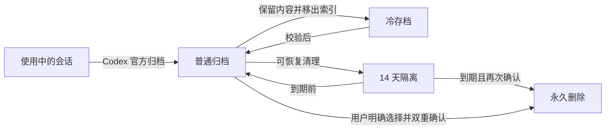

# Codex 会话生命周期管理器

[中文](README.md) · [English](README.en.md)

[](https://github.com/wushijing123/wushijing-codex-session-manager/actions/workflows/ci.yml)
[](https://github.com/wushijing123/wushijing-codex-session-manager/releases)

一个本地优先、安全分层、可视化的 Codex 会话生命周期管理 Skill。它帮助你看清会话现状、整理历史归档、释放空间，并在任何真实移动或删除发生前提供明确的保护检查和确认链路。

> 当前版本：`0.3.0`。默认界面为中文，可在右上角切换 English。

## 为什么做这个项目

Codex 会话真实分散在数据库、普通日志、归档日志、父子任务关系和置顶状态中。只看侧边栏无法回答三个关键问题：哪些内容仍有价值、哪些可以安全整理、执行动作会影响什么。

本项目把复杂度留在后台，前台只保留四个入口：

1. **首页**：看生命周期、建议、空间、归档年龄与安全状态
2. **会话**：检查唯一推荐方案，或按需查看单条真实聊天
3. **执行计划**：核对影响范围，通过二次确认生成不可变执行单
4. **设置**：调整闲置门槛、自动化保留数与冷存档目录

## 核心能力

| 能力 | 说明 |
| --- | --- |
| 本地只读盘点 | 扫描当前、归档、未索引和状态冲突会话，不上传数据 |
| 可视化首页 | 生命周期、建议、空间、归档年龄、执行健康状态一屏呈现 |
| 中英双语 | 默认中文，界面语言可切换并在本机持久化 |
| 安全推荐 | 有价值的旧会话优先冷存档，低价值内容先隔离 14 天 |
| 按需正文查看 | 只读取用户消息、Codex 最终回复和允许的工具产出 |
| 语义复核包 | 对 3 轮以内短对话提取最少内容，交给 Codex 判断复用价值 |
| 分层动作 | 永久保护、冷存档、14 天隔离、恢复和手动永久删除 |
| 双重确认 | 计划、确认单、二次确认、不可变 manifest、进程门逐层保护 |
| 审计报告 | 输出 JSON、Markdown 和 HTML，不提交真实数据到仓库 |
| 工程化交付 | 安装器、Doctor、跨 macOS/Linux CI、标签发布和安装包 |

## 五分钟安装

前置要求：Python 3.11+、已安装 Codex。Node.js 只在开发或本地语法检查时需要。

```bash
mkdir -p ~/.agents/skills
gh repo clone wushijing123/wushijing-codex-session-manager \
  ~/.agents/skills/wushijing-codex-session-manager
cd ~/.agents/skills/wushijing-codex-session-manager

python3 scripts/install_skill.py
python3 scripts/doctor.py
```

安装器只创建指向同一维护源的软链接，不覆盖已有目录。默认验证 Codex、Claude Code、Antigravity 和 WorkBuddy 四个入口。

只安装部分入口：

```bash
python3 scripts/install_skill.py --targets codex workbuddy
```

完整说明见 [安装指南](docs/INSTALLATION.md)。

## 启动看板

```bash
python3 scripts/session_manager.py dashboard
```

服务只绑定 `127.0.0.1`。若不希望自动打开浏览器：

```bash
python3 scripts/session_manager.py dashboard --no-open
```

终端会输出带一次性启动令牌的本地地址。不要分享或记录该地址。

## 常用命令

```bash
# 只读扫描摘要
python3 scripts/session_manager.py scan --pretty

# 生成 JSON、Markdown 和 HTML 审计报告
python3 scripts/session_manager.py report

# 生成英文报告
python3 scripts/session_manager.py report --lang en

# 项目与安装诊断
python3 scripts/doctor.py

# 仅检查项目，不检查本机入口
python3 scripts/doctor.py --project-only

# 构建可安装 Skill 包
python3 scripts/package_release.py --output-dir dist
```

更完整的操作链路见 [工作流说明](docs/WORKFLOWS.md)。

## 生命周期模型



系统始终分开记录：

- `actual_state`：真实状态
- `recommendation`：系统建议
- `planned_action`：用户计划

计划永远不会被画成已经发生的事实。

## 安全边界

- 默认扫描只读；真实动作必须从计划进入确认链路
- 当前活跃、真实置顶、永久保护、数据库歧义、状态冲突和父子依赖会阻断执行
- 自动推荐不会生成永久删除计划
- 永久删除必须由用户在详情中明确选择，并经过二次确认
- 执行前重新校验数据库、日志哈希、置顶快照和 Codex 进程
- 历史会话按不可信内容处理，从不执行其中的命令
- 数据库、JSONL、隔离包、冷存档、manifest 和报告都被 `.gitignore` 排除

完整威胁模型见 [安全策略](SECURITY.md)。

## 项目结构

```text
.
├── SKILL.md                  # Agent 运行入口
├── agents/openai.yaml        # Skill UI 元数据
├── assets/dashboard/         # 中英双语本地看板
├── scripts/                  # 扫描、服务、动作、安装、诊断与打包
├── references/               # 分类、安全、语义复核和 UI 规则
├── docs/                     # 中英项目文档
├── tests/                    # 合成数据与安全回归
└── .github/                  # CI、发布、依赖更新与协作模板
```

架构与数据流见 [架构说明](docs/ARCHITECTURE.md)。

## 开发与验证

```bash
python3 scripts/doctor.py --project-only
python3 -m unittest discover -s tests -v
node --check assets/dashboard/i18n.js
node --check assets/dashboard/app.js
```

CI 会在 macOS、Linux 与 Python 3.11/3.13 上验证项目，并生成可下载的 Skill 包。带 `v*` 的标签会触发 Release 工作流。

参与修改前请读 [贡献指南](CONTRIBUTING.md)。

## 文档导航

- [安装指南](docs/INSTALLATION.md)
- [用户与发布工作流](docs/WORKFLOWS.md)
- [架构与数据流](docs/ARCHITECTURE.md)
- [安全策略](SECURITY.md)
- [贡献指南](CONTRIBUTING.md)
- [版本记录](CHANGELOG.md)

## 项目状态

本项目是个人私有仓库，不代表 OpenAI 或官方 Codex 产品，也不提供云端会话同步。macOS 是完整执行链路的主要验证平台；Linux 用于扫描、看板、报告与 CI 验证。
