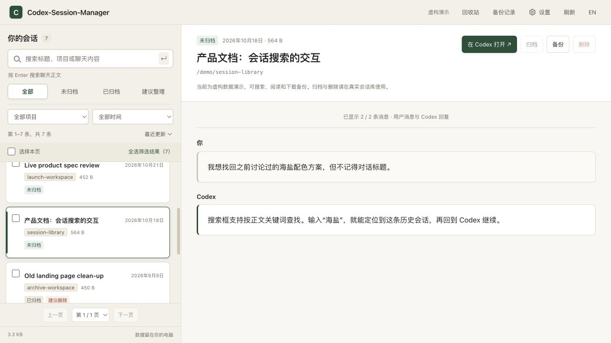

# Codex-Session-Manager

[中文](README.md) · [English](README.en.md)

一个在本机搜索、阅读和整理 Codex 历史会话的工具。MIT License。

当前版本：`0.7.0`。

使用会话列表和聊天阅读双栏。搜索旧对话、回到 Codex 继续聊，或直接归档、备份和删除。

## 功能

| 需要做什么 | 操作 |
| --- | --- |
| 找旧 session | 输入关键词筛选标题、项目或 ID；按 Enter 搜索聊天正文 |
| 看历史聊天 | 默认过滤自动注入的插件、配置及 Skill 上下文，点击会话阅读真实用户消息和 Codex 回复，Markdown 表格、代码、列表正常排版，支持本地／日志内嵌图片预览及点击查看原图；长会话分段加载，兼容压缩日志及新版消息格式 |
| 继续聊 | 点击“在 Codex 打开”，跳到原会话 |
| 归档 | 直接通过官方接口归档，也可取消归档 |
| 备份 | 保存原始 JSONL、校验哈希和会话数据库行，下载本地 ZIP，在备份记录中恢复 |
| 删除 | 校验恢复副本后调用官方删除，成功后进入回收站保留 30 天，无确认单和二次弹窗 |
| 回收站 | 单条恢复、勾选及全选永久删除；启动、刷新或打开回收站时清理到期副本 |
| 看整理建议 | 筛选“建议整理”，查看建议归档／删除的理由 |

列表支持项目与闲置时间筛选，每页 50 条，显示条目范围与总数，可上一页／下一页及页码跳转，跨页保留勾选。勾选列表左侧复选框，或全选当前筛选结果，即可批量归档、取消归档、备份和删除；后台显示进度和逐项结果，删除自动保留每条备份。

“建议整理”内可单选全部／未归档／已归档。选中后点击“按建议处理”，分别执行每条会话的归档或删除建议；先展示数量，删除自动备份。建议仅基于本地规则，不自动执行。当前会话、已知保护及关联任务不会成为删除候选。回收站副本在 30 天到期后清理；服务关闭期间会延后到下次启动或打开时清理。手动备份和旧版副本不自动过期。永久删除回收站副本后，不能再从回收站恢复。

归档只改变日常会话展示，不等于释放磁盘空间。会话打开深链是 `codex://threads/SESSION_ID`，需要系统安装支持该协议的 Codex 应用。

## 设置与外观

首页右上角“设置”可选择备份保存文件夹，支持系统选择器或完整路径；首次手动备份也会先选择目录。改位置不会移动旧文件。每份 ZIP 以 `会话ID-随机标识.zip` 命名，标题和时间在备份记录中查看。单条和批量备份显示真实进度并支持取消，保留已完成文件、清理未完成文件；关闭进度窗口则继续后台执行。

提供 **B 暖白阅读（默认）／A 浅色极简／C 深色工作台** 三套主题，点击立即生效并记住本浏览器选择。



当前只管理本地 Codex 会话。Claude Code 支持尚未实现；在 Claude Code 中安装此 Skill 不等于接入它的会话。

## 安装与启动

需要 Python 3.11+、Git、Codex CLI 和已运行过的 Codex。

```bash
mkdir -p ~/.agents/skills
git clone https://github.com/wushijing123/Codex-Session-Manager.git \
  ~/.agents/skills/codex-session-lifecycle-manager
cd ~/.agents/skills/codex-session-lifecycle-manager
python3 scripts/install_skill.py
python3 scripts/session_manager.py dashboard
```

已有安装直接在维护源目录更新。安装器创建软链接，不覆盖已有目录。

在 Codex 中也可以说：

```text
使用 $codex-session-lifecycle-manager 打开会话库
```

服务只绑定 `127.0.0.1`。终端会打印带启动令牌的地址，请保持服务运行，不要分享该地址。默认中文，可切换 English。聊天数据不上传。

## 先试虚构数据

```bash
python3 scripts/demo_dashboard.py --no-open
```

演示包含搜索关键词、历史对话、归档建议、删除建议和旧版包。默认使用临时目录，退出后清理，不读取真实会话。演示可以搜索、阅读和备份，归档／删除保持禁用。

## 兼容性与边界

- 支持的操作以本机 Codex 生成的协议 schema 为准。老 CLI 可能支持归档而不支持 `thread/delete`；页面会禁用删除并提示更新，不自行升级系统 CLI。
- 归档、取消归档和删除调用官方接口，不直接修改 Codex 数据库。官方拒绝会话当前正在写入时，不强制操作。
- 备份 ZIP 包含原始聊天与会话行，不包含凭证或完整数据库；支持下载和恢复。恢复先校验哈希与会话 ID，经官方接口重新识别，不覆盖现有会话；旧备份继续兼容。压缩备份恢复为普通 JSONL，保留原 ID、正文及归档状态；不承诺还原所有内部数据库字段或原始排序时间。
- 对话每页 20 条，可加载超过 200 条。超长单条消息仍使用原解析器的文本上限。
- 旧版冷存档、隔离数据仍可盘点，恢复使用旧命令；新版页面不提供冷存档、隔离或执行计划。
- 支持 `.jsonl`、`.jsonl.zst`、新版 `item_completed` 以及混合历史；只在磁盘确实不存在日志时标为缺失。扫描遵循 `CODEX_HOME`、配置 `sqlite_home` 与 `CODEX_SQLITE_HOME`，同一会话的重复格式不重复计数。
- 压缩阅读需要 Python 3.14 标准库、Python `zstandard` 包或系统 `zstd` 命令之一；例如 `python3 -m pip install zstandard`。使用流式解压，不生成聊天正文缓存。
- 浏览器中验证了桌面与 375px 窄屏；系统深链能否打开取决于本机 Codex 安装。

## 开发检查

```bash
python3 -m unittest discover -s tests -q
python3 scripts/doctor.py --project-only
node --check assets/dashboard/app.js
node --check assets/dashboard/i18n.js
```

更多信息：[安装](docs/INSTALLATION.md)、[变更记录](CHANGELOG.md)、[安全说明](SECURITY.md)。`docs/WORKFLOWS.md` 和旧截图记录 0.6 版冷存档／隔离流程，供旧数据兼容维护参考。
