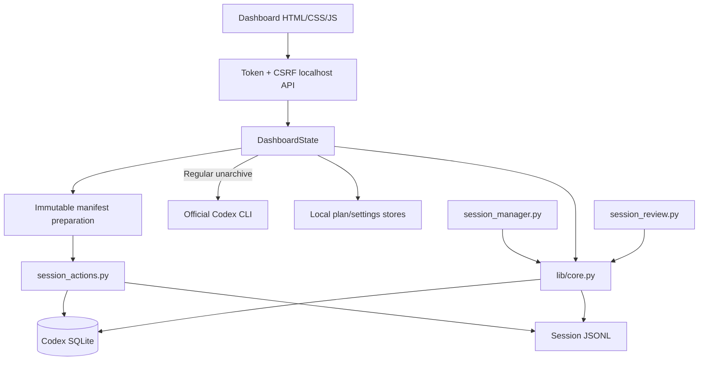

# Architecture

[中文](ARCHITECTURE.md) · [English](ARCHITECTURE.en.md)

## Design goals

1. Local first — no remote service and no session-content upload
2. Separate fact from intent — actual state, recommendation, and plan never merge
3. Layer destructive actions — scan, plan, confirm, prepare, and execute are independent
4. Prefer recovery — automatic recommendations use cold storage or 14-day quarantine only
5. Keep the UI small — complex validation stays in the background

## Components

### `scripts/lib/core.py`

- Discovers and scores Codex database candidates
- Matches indexed records with real logs
- Builds parent-child relationships
- Computes protection, classification, size, and summaries
- Produces JSON, Markdown, and HTML reports

### `scripts/lib/server.py`

- Binds only to `127.0.0.1`
- Uses a one-time launch token for initial authorization
- Requires a CSRF token for every POST request
- Manages settings, plans, receipts, and manifests
- Uses only the official Codex CLI for regular unarchive, then treats the rescanned state as the final result
- Never bypasses the action script to mutate real data

### `scripts/session_actions.py`

- Verifies that Codex has quit
- Validates immutable manifests, file hashes, and targets
- Executes cold storage, quarantine, restore, or permanent deletion
- Uses transactions, temporary copies, and consistent backups for rollback

### Dashboard

- `index.html` — semantic structure
- `style.css` — responsive visuals and accessibility states
- `i18n.js` — Chinese default plus the English catalog
- `app.js` — rendering, filtering, planning, and confirmation

Language switching changes copy and date formats only. It does not change actions, APIs, or storage.

## State model

### `actual_state`

`active`, `archived`, `cold`, `quarantine`, `unindexed`, `missing`

### `recommendation`

`protected`, `high_value`, `cold_archive`, `delete_candidate`, `permanent_delete_candidate`, `review_required`, `unknown`

### `planned_action`

`cold_archive`, `quarantine`, `permanent_delete`, `purge_after_quarantine`, plus read-only legacy markers.

## Local data

`default_app_dir()` selects the platform-specific application data directory. It stores settings, plans, receipts, manifests, protections, semantic-review cache, and audit records. Real logs remain under Codex or user-selected cold storage and quarantine locations.

The repository never needs real session data. Tests use temporary directories and synthetic databases only.

## Database selection

Candidates are evaluated by schema, recency, thread count, matching log count, and match ratio. If two candidates are equally credible, `database_ambiguous=true` and all execution is disabled.

## Consistency boundary

- A scan is not execution authorization
- A plan is not actual state
- A receipt expires when the plan changes
- A manifest binds the database, session IDs, paths, sizes, and hashes
- Codex processes and files are checked again before execution
- A new scan verifies every completed action

## Test strategy

- Classification and database ambiguity
- WAL visibility and unindexed logs
- Parent-child, pinned, and protection blockers
- Cold storage/restore, quarantine/restore, and permanent deletion
- Interrupted rollback, hash drift, and schema drift
- Content-search and conversation-preview safety
- Exact-ID, state-gate, and rescan coverage for official unarchive
- Chinese/English translation coverage
- Installer conflicts, Doctor, and release package structure
- macOS process gate and helper state
