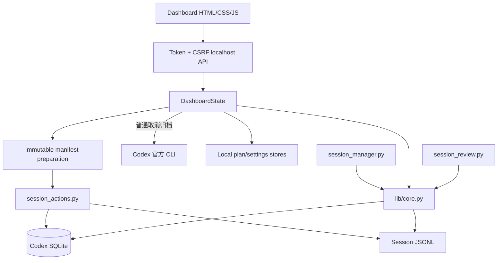

# 架构说明

[中文](ARCHITECTURE.md) · [English](ARCHITECTURE.en.md)

## 设计目标

1. 本地优先：不依赖远程服务，不上传会话内容
2. 事实与意图分离：真实状态、建议和计划永远分开
3. 破坏性动作分层：扫描、计划、确认、准备、执行各自独立
4. 可恢复优先：自动推荐只使用冷存档或 14 天隔离
5. 最少界面：复杂校验在后台，用户只处理明确下一步

## 组件

### `scripts/lib/core.py`

- 发现并评分 Codex 数据库候选
- 匹配索引与真实日志
- 建立父子任务关系
- 计算保护、分类、大小与摘要
- 生成 JSON/Markdown/HTML 报告

### `scripts/lib/server.py`

- 只绑定 `127.0.0.1`
- 使用一次性 launch token 建立会话
- 所有 POST 请求要求 CSRF token
- 管理设置、计划、确认单和 manifest
- 普通取消归档只调用 Codex 官方 CLI，并重新扫描验证
- 不直接绕过动作脚本修改真实数据

### `scripts/session_actions.py`

- 校验 Codex 进程已经退出
- 验证不可变 manifest、文件哈希和目标路径
- 执行冷存档、隔离、恢复或永久删除
- 使用事务、临时副本和一致性备份处理失败回滚

### Dashboard

- `index.html`：语义结构
- `style.css`：响应式视觉和可访问性状态
- `i18n.js`：默认中文与英文翻译目录
- `app.js`：渲染、筛选、计划与确认交互

语言切换只改变文案和日期格式，不改变动作、API 或存储模型。

## 状态模型

### `actual_state`

`active`、`archived`、`cold`、`quarantine`、`unindexed`、`missing`

### `recommendation`

`protected`、`high_value`、`cold_archive`、`delete_candidate`、`permanent_delete_candidate`、`review_required`、`unknown`

### `planned_action`

`cold_archive`、`quarantine`、`permanent_delete`、`purge_after_quarantine`，以及只读兼容的旧版标记。

## 本地数据

默认应用数据目录由 `default_app_dir()` 按平台决定，包含设置、计划、确认单、manifest、保护项、复核缓存和审计。真实会话日志继续保留在 Codex 目录或用户选择的冷存档/隔离目录。

仓库从不需要真实会话数据。测试全部使用临时目录和合成数据库。

## 数据库选择

系统检查所有候选数据库的 schema、更新时间、线程数量、日志命中量和命中比例。如果两个候选同样可信，`database_ambiguous=true`，所有执行动作关闭。

## 一致性边界

- 扫描结果不是执行授权
- 计划不是已经发生的状态
- 确认单在计划变化后失效
- manifest 绑定数据库、会话 ID、路径、大小和哈希
- 执行前再次检查 Codex 进程与文件状态
- 执行后必须重新扫描验证

## 测试策略

- 分类与数据库歧义
- WAL 可见性与未索引日志
- 父子任务、置顶和保护阻断
- 冷存档/恢复、隔离/恢复、永久删除
- 中断回滚、hash 漂移、schema 漂移
- 正文搜索和聊天预览安全
- 官方取消归档的精确 ID、状态门与重新扫描
- 中英翻译覆盖
- 安装冲突保护、Doctor 和发布包结构
- macOS 进程门与执行助手状态
