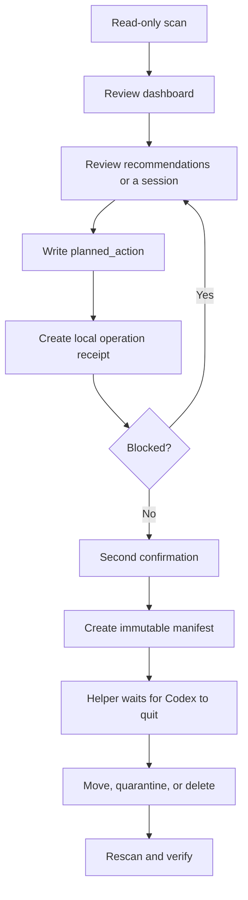

# Workflows

[中文](WORKFLOWS.md) · [English](WORKFLOWS.en.md)

## Main user flow



### 1. Scan and dashboard

The local service performs a read-only scan before the dashboard opens. Home shows actual state, recommendations, storage, archive age, and safety gates without simulated progress.

### 2. Recommended organization

There is one default strategy:

- Reusable or large old sessions → cold storage
- Low-value, short temporary, or old automation history → 14-day quarantine
- Unknown, review-required, hard-protected, or related sessions → no automatic plan
- Permanent deletion → never generated automatically

### 3. Manual review

Opening a session reads one regular log on demand. The UI shows only real user messages, final Codex responses, and allowed tool outputs. System prompts and tool arguments remain hidden.

### 4. Plan

Cold storage, quarantine, and permanent deletion actions only change `planned_action`; they never move or delete files immediately. Unarchiving a regular archived session is the exception: the detail action calls the official `codex unarchive SESSION_ID` command and then rescans without editing SQLite directly. The verified state wins over the CLI exit code: a returned session is reported as successful, while a session that remains archived is reported as failed. Legacy `archive` and `unarchive` plan markers remain non-executable history.

### 5. Confirm and execute

The receipt rescans and checks the database, pinned state, relationships, actual state, log paths, and size. Second confirmation creates immutable manifests. The action script rechecks hashes and Codex processes.

## Lifecycle actions

### Unarchive a regular session

The detail view exposes **Unarchive** for regular archived sessions. It passes only the exact scanned session ID to the official Codex CLI and rescans after success. Conflicting, unindexed, cold-stored, or quarantined sessions cannot use this path.

### Permanent protection

Blocks automatic organization and execution for important long-term references or projects.

### Cold storage

Keeps full content and restore capability outside the active index. It is the preferred path for large or valuable history.

### 14-day quarantine

The default recoverable cleanup path. A session can be restored during quarantine. Expired packages still require another confirmation before permanent deletion.

### Permanent deletion

Available only through an explicit action on a regular archived session. Automatic rules cannot add it. Successful deletion retains only a redacted audit record, not the title, content, or original path.

## Archived content search

Content search handles regular archived logs only. It narrows candidates with byte matching and returns redacted excerpts. It does not build a full-text index, read tool arguments, use the network, or execute historical instructions.

## Short-conversation semantic review

```bash
python3 scripts/session_review.py prepare --max-user-turns 3
```

The bundle contains only the minimum content needed to judge reuse value. Codex results must pass structure and completeness validation before they enter the local cache.

## Reports

```bash
python3 scripts/session_manager.py report --lang en --output-dir /absolute/report/path
```

Generated files:

- `codex-session-audit.json`
- `codex-session-audit.md`
- `codex-session-audit.html`

Report directories are ignored by Git. Never commit real reports.

## Development workflow

1. Create a branch from `main`
2. Change only files directly related to the goal
3. Update Chinese and English copy together
4. Run Doctor, tests, and JavaScript syntax checks
5. Review the dashboard at 375px and desktop width
6. Open a pull request and declare safety impact

## Release workflow

1. Update `VERSION` and `CHANGELOG.md`
2. Complete local verification
3. Commit and push `main`
4. Wait for CI
5. Create and push a tag matching VERSION

```bash
release_version=$(cat VERSION)
git tag -a "v${release_version}" -m "Release v${release_version}"
git push origin "v${release_version}"
```

The Release workflow validates again, builds the runtime ZIP, and creates or updates the GitHub Release.
