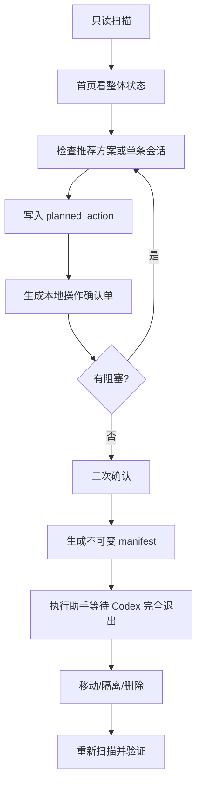

# 工作流说明

> 本文记录 v0.6 旧版冷存档／隔离流程；v0.7.0 会话库请阅读 [README](../README.md)。
[中文](WORKFLOWS.md) · [English](WORKFLOWS.en.md)

## 用户主流程



### 1. 扫描与首页

服务启动时已经完成只读扫描。首页展示真实状态、推荐、空间、归档年龄和安全门，不播放模拟进度。

### 2. 推荐整理

唯一默认方案：

- 有复用价值或体积较大的旧会话 → 冷存档
- 低价值、短临时对话和较早自动化历史 → 14 天隔离
- 未知、待复核、硬保护、父子任务组 → 不自动规划
- 永久删除 → 永远不由推荐方案生成

### 3. 人工查看

点击会话后，按需读取单个普通日志。页面只显示真实用户消息、Codex 最终回复和允许的工具产出，不显示系统提示或工具参数。

### 4. 执行计划

冷存档、隔离和永久删除只改变 `planned_action`，不会立即移动或删除文件。普通已归档会话详情中的“取消归档”是例外：它调用 Codex 官方 `codex unarchive SESSION_ID`，命令结束后立即重新扫描，不直接修改 SQLite。旧版 `archive` / `unarchive` 计划标记仍折叠为历史信息。

### 5. 确认与执行

确认单重新扫描并核对数据库、置顶、父子关系、状态、日志路径和大小。二次确认后生成不可变 manifest。动作脚本再次校验哈希和 Codex 进程。

## 生命周期动作

### 取消普通归档

普通已归档会话在详情中提供“取消归档”。按钮只传递扫描结果中的精确 Session ID，调用 Codex 官方 CLI，并在命令结束后重新扫描验证。重新扫描后的真实状态优先于 CLI 退出码：状态已经返回就显示成功，仍为归档才显示失败。状态冲突、未索引、冷存档和隔离会话不能走这条路径。

### 永久保护

阻止自动整理与执行，适合长期参考、关键项目或高价值会话。

### 冷存档

保留完整内容和恢复能力，但移出当前索引。适合大体积或仍有价值的历史会话。

### 14 天隔离

默认可恢复清理路径。隔离期内可以恢复；到期后仍需再次确认才能永久删除。

### 永久删除

只接受普通归档会话中的用户明确选择。自动规则无权加入。执行后只保留脱敏审计，不保留标题、正文或原路径。

## 正文搜索

正文搜索只处理普通归档日志，使用字节匹配缩小范围，再返回脱敏片段。它不建立全文索引，不读取工具参数，不联网，也不执行历史指令。

## 短对话语义复核

```bash
python3 scripts/session_review.py prepare --max-user-turns 3
```

复核包只包含判断复用价值所需的最少内容。Codex 输出写回本地缓存前必须满足结构和完整性校验。

## 报告工作流

```bash
python3 scripts/session_manager.py report --output-dir /absolute/report/path
```

英文报告：

```bash
python3 scripts/session_manager.py report --lang en --output-dir /absolute/report/path
```

生成：

- `codex-session-audit.json`
- `codex-session-audit.md`
- `codex-session-audit.html`

报告目录默认处于 Git 忽略范围。不要把真实报告提交到仓库。

## 开发工作流

1. 从 `main` 创建分支
2. 只修改与目标直接相关的文件
3. 中英文案同时补齐
4. 运行 Doctor、测试和 JS 语法检查
5. 用 375px 与桌面尺寸检查 Dashboard
6. 提交 PR，填写安全影响

## 发布工作流

1. 更新 `VERSION` 和 `CHANGELOG.md`
2. 本地完成所有验证
3. 提交并推送 `main`
4. 等待 CI 通过
5. 创建并推送与 VERSION 一致的标签

```bash
release_version=$(cat VERSION)
git tag -a "v${release_version}" -m "Release v${release_version}"
git push origin "v${release_version}"
```

Release 工作流会重新验证、构建运行时 ZIP，并创建或更新 GitHub Release。
